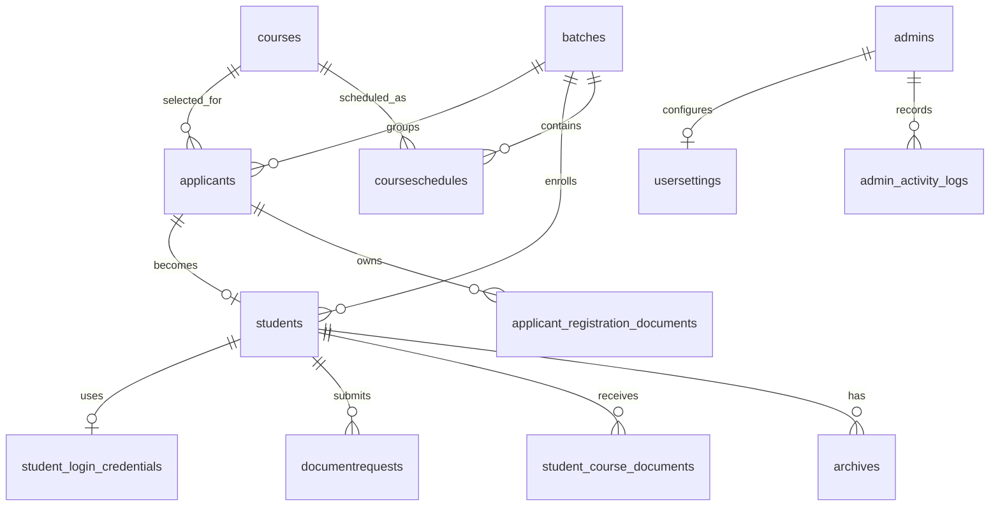

# ABEC database audit — November 7, 2026

**Assessment: the database has a sound basic relational structure, but the system is not ready for unrestricted production use with personal records.** The most urgent issue is access control in the application. Database integrity and operational consistency also need work before the system can be treated as dependable.

This is an audit, not a repair. No existing application source, database schema, records, accounts, or uploaded documents were modified. No email was sent. A private audit collector and new documentation were created.

## What was actually examined

| Evidence | Scope and confidence |
|---|---|
| Live local MySQL | Inspected November 7, 2026 at **4:32 PM Philippine time**. Read-only, repeatable-read transaction; `transaction_read_only=1` verified. Metadata, exact row counts, existing foreign keys, additional relationship checks, aggregate data quality, file existence/size, and three `EXPLAIN` plans. |
| Current repository | EF model, migration and snapshot, startup SQL, configuration, controllers, repositories, and application services. Findings marked **source verified** describe code behavior; they are not a claim that an attack or concurrent failure was executed. |
| Azure | Existing same-day schema snapshot at 3:39 PM, committed import result at 3:39:44 PM, import/QA documentation. **Not a fresh direct Azure inspection.** No Azure database credential was available in this audit process. |
| Build/model/checklist checks | Release build succeeded with zero errors and two transient DLL-copy retry warnings. EF reported no model changes since the last migration. That compares code with its snapshot; it does not prove a live database matches them. The supplied SQL checklist executed successfully against local MySQL, returning 20 result sets. |

The web app was not started for this audit, because its startup routine changes the database. Mutating endpoints were not called. Some GET endpoints also write records, so API browsing was not used as a substitute for a read-only SQL audit.

Private machine evidence: `App_Data/database-audit/local-audit.json`. The new collector is in `App_Data/database-audit/Program.cs`. Both are excluded from Git and publishing by existing project rules. The shareable aggregate evidence is [database-audit-evidence-2026-11-07.json](database-audit-evidence-2026-11-07.json). It contains no names, contact details, passwords, PINs, or document paths.

## Plain-language explanation of the database

Think of the database as connected filing cabinets. Each table holds one kind of record. A primary key is the internal number of a record. A foreign key is an enforced link to another cabinet: a student must reference an existing applicant. A unique index prevents duplicates, such as two student accounts for the same application. A transaction makes a group of database changes succeed or fail together.

Your application uses **MySQL with Entity Framework Core**, through Pomelo and MySqlConnector. It is not SQL Server despite being a .NET project. The configured local database is `localhost:3306/abec_system`; Azure uses `abecdb01`. These are separate databases, not automatically synchronized copies. Later local changes do not automatically appear in Azure.

The business structure is:

1. A person submits an **application**, tied to a course and batch.
2. Staff review the application and send an offer.
3. Confirmation creates a **student account/seat**, initially pending activation.
4. Activation allows login. Optional username/password credentials live in a separate table.
5. Schedules connect courses and batches. Registration uploads belong to applicants.
6. Student course documents track preparation; document requests track requests and release processing.
7. Archive and history tables record selected lifecycle information. An archive is a business status, **not a backup**.

This diagram explains intended ownership. It does not imply every link is enforced in both databases. Notifications, student activity, course history, batch history, and room links are discussed below.

## Actual inventory

The local database contains **18 application tables, 442 rows, MySQL 8.0.46, and InnoDB throughout**. Its allocated data plus indexes total about 752 KiB. This is a small database; storage capacity is not the immediate concern.

| Table | Local rows | Purpose |
|---|---:|---|
| `admins` | 2 | Website administrator accounts |
| `admin_activity_logs` | 75 | Selected administrator activity |
| `usersettings` | 1 | Administrator preferences; also duplicates credentials |
| `applicants` | 24 | Registration, identity/profile, decisions, slot response |
| `applicant_registration_documents` | 31 | Metadata and paths for registration uploads |
| `students` | 6 | Account, PIN, and batch membership |
| `student_login_credentials` | 0 | Optional student username/password login |
| `student_activity_logs` | 7 | Successful student login history |
| `courses` | 4 | Course catalog, program duration, capacity |
| `batches` | 3 | Semester/batch windows; one currently Active |
| `batchhistory` | 34 | Batch lifecycle events |
| `courseschedules` | 7 | Course/batch timetable, room, trainers |
| `trainingrooms` | 10 | Room catalog |
| `course_management_history` | 15 | Schedule and capacity change notes |
| `documentrequests` | 8 | Requests and release processing |
| `student_course_documents` | 15 | Credential preparation and uploaded-file metadata |
| `notifications` | 199 | Student, applicant, and admin-facing messages |
| `archives` | 1 | Current archive reason/status record |
| **Total** | **442** | |

Local application statuses: 7 Confirmed Slot, 6 Approved, 4 Rejected, 3 Pending, 3 Expired, and 1 Waitlisted. Student accounts: 4 Active and 2 Inactive. Requests: 2 Processing, 3 Released, 2 On Hold, and 1 Pending. All 15 course-document rows are Not Prepared.

The local Active batch is ID 5, November 9, 2026–January 9, 2027. At inspection, none of the six local student rows belongs to this Active batch. Therefore, active-batch capacity counts correctly show zero occupied seats for each course even though historical students exist. An Active account and an Active batch are different concepts.

The prior Azure import evidence records 18 application tables plus one EF history table, 19 foreign-key relationships, 25 applicants, 7 students, 3 admins, and 1 student credential row. Azure includes synthetic QA accounts. Login activity can increase its log counts after the import. See [the import report](local-to-azure-import-review.md).

## What is working well

- All **16 declared local foreign-key relationships** have zero orphan rows. Additional checks on the three relationships missing locally also found zero current orphans.
- No applicant is missing a batch; student and applicant batch IDs agree; exactly one batch is Active.
- No duplicate normalized email groups were found within a batch.
- Existing unique rules protect usernames, one student per applicant, student PINs, and one course-document row per student/type locally.
- No current course-document batch/course ownership mismatch, notification/applicant ownership mismatch, or notification/request student mismatch was found.
- No current invalid schedule time range, missing referenced room ID, empty trainer, or invalid stored trainer JSON was found after explicitly resolving collation in the audit query.
- Both local admin password values have BCrypt-style prefixes. This is a format check, not proof of password strength. No hashes were printed or exported into this report.
- All 27 locally available referenced files have the recorded byte size. There are no file references outside the workspace in the checked set. Contents were not validated or hashed.
- EF tooling has a design-time factory that avoids starting the application's seeding routine. Local settings/private data are ignored and excluded from publish inputs.

Passing these checks means the specific checks passed. It does not establish complete consistency, authorization, backup coverage, or load capacity.

## Findings and priorities

**Critical** means address before public use with personal records. **High** means a substantial reliability, security, or business-integrity risk. **Medium** means a scaling, maintainability, or data-quality issue that should be scheduled.

### DB-01 — Critical: application access control does not protect the database

**Source verified.** Applicant lists/details/files, legacy student profile APIs, activation, archive, schedule, and document-request controllers lack server authorization. `Program.cs` has no fallback policy. `StudentAccountController` is protected, but that does not protect the other controllers. Admin login returns a role/ID response without issuing an authenticated admin session. `X-Abec-Admin-Id` comes from the client and is used for attribution and some permission checks.

**Meaning:** a visitor can reach sensitive database operations through routes that do not require the server to verify who they are. A frontend redirect or hidden button does not prevent direct API calls. A supplied admin ID is a claim made by the caller, not proof of identity.

**Action:** introduce an authenticated admin session and explicit Admin policies. Require Student authentication and ownership on student routes; derive IDs from validated claims. Keep only deliberate public routes anonymous, such as enrollment and token-based slot responses. Test anonymous, wrong-role, and another-student access for every sensitive operation. Fix authorization before treating encryption or database constraints as sufficient protection.

Evidence: [ApplicantController](../../Controllers/ApplicantController.cs), [StudentApiController](../../Controllers/StudentApiController.cs), [AuthController](../../Controllers/AuthController.cs), [CourseDocumentController](../../Controllers/CourseDocumentController.cs), [CourseHistoryRecorder](../../Services/CourseHistoryRecorder.cs), [Program](../../Program.cs).

### DB-02 — Critical: reusable PINs are exposed and derived from personal information

**Source verified.** Profile and some list DTOs include `SecurityPin`. The legacy profile route is unprotected. `SecurityPinGenerator` constructs a PIN from name letters, birth day, contact digits, and registration day. Student login compares the stored PIN directly. The public `/api/auth/register` can set an account Active when its PIN matches; it does not establish a new password credential.

**Meaning:** the system exposes a value used to log in, and some generated values can be inferred from personal information. The combination of exposed profile/PIN and missing authorization is more serious than either issue alone. Batch guards can block writes to closed batches, but do not secure profile reads.

**Action:** remove login secrets from general DTOs; use a random, expiring, single-use activation token stored as a hash; establish password credentials through controlled activation. Disable or redesign the legacy registration endpoint. Review revocation of exposed PINs after fixing access control. Do not automatically rotate credentials during an audit.

Evidence: [StudentPortalService](../../Services/StudentPortalService.cs) around line 97, [SecurityPinGenerator](../../Services/SecurityPinGenerator.cs), [AuthService](../../Services/AuthService.cs) around lines 69–80 and 106–137, [DbSeeder](../../Data/DbSeeder.cs) around line 89.

### DB-03 — High: runtime database access uses excessive privileges

**Live local verified.** The configured application login is MySQL `root`, has global privileges including DROP, CREATE USER, FILE, and grant rights, and connects without TLS. `require_secure_transport=0` locally. A password is stored in the local settings file, which is currently ignored and untracked. This audit does not establish whether it exists in older history or external artifacts.

**Audit handling disclosure:** one configuration-inspection command inadvertently emitted the local connection string into this chat's tool output. The password is absent from all three audit deliverables, as checked before delivery. Treat that local password as exposed in the transcript and rotate it separately; the audit did not change credentials.

**Meaning:** compromise of the web process could affect the whole local database server, beyond this application's records. Loopback use limits network exposure, but does not reduce the account's privileges.

**Action:** separate a restricted runtime account from an upgrade/deployment account. Runtime should receive only the operations it needs on the application schema, with no global administration or schema-change rights. Move credentials into appropriate development/hosting secret configuration. Check actual Azure grants independently; the account name in setup documentation does not establish its privileges.

Azure documentation uses `SslMode=Required`. With MySqlConnector this encrypts traffic but does not validate CA/hostname; use and test `VerifyFull` where the platform trust configuration supports it. The previous import helper used VerifyFull, but that does not prove the deployed app does. [Provider connection options](https://mysqlconnector.net/connection-options/).

### DB-04 — High: local contact duplicates block the integrity upgrade

**Live local verified.** Within historical batch 1 there are **four normalized duplicate-phone groups affecting 11 applicants**, or seven records beyond one per group. The same number in `09...` and `+639...` form is counted as one contact. There are no duplicate normalized email groups.

`EnsureBatchIntegritySchemaAsync` stops on those duplicates before adding the normalized contact/email columns and unique indexes. These columns/indexes are absent locally. The check examines all applicants, including closed batches. Therefore historical duplicates still block startup upgrade work even though the active batch has no duplicates.

**Meaning:** the local server can connect and display pages while part of its intended integrity upgrade is incomplete.

**Action:** review the affected records privately and decide whether they represent duplicate applications, shared family contacts, or erroneous test data. Preserve provenance and originals. Do not silently delete people or invent replacement real contact details. The Azure import's seven synthetic replacements were specifically authorized for that copy; that does not authorize changing local records or repeating the operation.

Evidence: [BatchSchema](../../Data/BatchSchema.cs), [import report](local-to-azure-import-review.md), aggregate evidence.

### DB-05 — High: the model, local schema, and Azure schema are not equivalent

**Live local plus recorded Azure verified.**

| Feature | Local now | Recorded Azure / migration |
|---|---|---|
| EF migration history | Absent | Initial migration recorded |
| Declared foreign-key links | 16 | 19 |
| Student activity → student | No FK | Cascade FK |
| Course document → student | No FK | Cascade FK |
| Training room → course | No FK | FK present |
| Archive/request/batch-history delete rules | Restrict | Cascade |
| Normalized batch contact/email keys | Absent | Runtime-generated columns and unique indexes present |
| `batches.completed_at` | Present, not mapped by EF | Added manually during the import, according to import evidence |
| Several statuses | MySQL ENUM | VARCHAR in EF migration |
| Several dates/timestamps | DATE / DATETIME | DATETIME(6) in migration |
| Course history query indexes | Course/date indexes exist | Initial Azure schema has primary key only |

The EF snapshot does **not** describe the runtime-generated normalized keys or legacy completion column. No pending EF model changes is therefore not a live-schema clean bill of health.

**Meaning:** a query, deletion, or fresh installation can behave differently in each environment. For example, a student deletion may be blocked locally but cascade related history in a migration-created database. The three missing FKs currently have no orphan rows; missing protection is still a future risk.

**Action:** choose and document the canonical schema, reconcile all environments through reviewed migrations, and include intended generated keys and operational indexes. Baseline the existing local database carefully; do not apply InitialCreate over occupied tables. Review delete policies before aligning them. Preserve `completed_at` until its intended ownership/use is settled.

Evidence: [ApplicationDbContext](../../Data/ApplicationDbContext.cs), [initial SQL](../../Migrations/InitialCreate.sql), local evidence, private same-day Azure schema snapshot.

### DB-06 — High: startup mixes upgrades, business updates, and ordinary application boot

**Source verified.** Every startup invokes many `CREATE`, `ALTER`, and `UPDATE` statements. It normalizes legacy statuses/document names, may rewrite student PINs, and reapplies official course program values. Some exceptions are swallowed. The outer startup catch logs a warning and continues. The batch duplicate failure stops later steps, but earlier upgrade steps can already have completed.

**Meaning:** restarting a website can change records or leave an incomplete upgrade. Two application instances starting together can race on check-then-alter logic. A green connectivity response does not verify upgrade completion.

**Action:** move schema and one-time data corrections into versioned deployment migrations/jobs. Run them once with a separate account and an explicit preflight. Ordinary application boot should validate required schema/version, and readiness should fail clearly if requirements are missing. Keep health/liveness distinct from database readiness.

MySQL schema statements such as ALTER TABLE and CREATE INDEX can implicitly commit; a surrounding transaction is not a general rollback solution for this startup sequence. [MySQL implicit commits](https://dev.mysql.com/doc/refman/8.4/en/implicit-commit.html).

Evidence: [DbSeeder](../../Data/DbSeeder.cs), [BatchSchema](../../Data/BatchSchema.cs), [Program](../../Program.cs) around lines 154 and 248.

### DB-07 — High: schedule conflict handling and historical protection are incomplete

**Source verified; historical-state inconsistency live verified.** `HasConflictAsync` returns a failed response for an occupied room. Create and update only reject a result when `Success && Data` is true. The occupied-room failure therefore bypasses their rejection checks. Trainer conflict checks consider only the primary trainer and matching start date; recurring weekdays and secondary trainer assignments are not fully represented.

The single-active-schedule guard is per course across all batches. Four stored schedules are Active in closed batches. Neither `BatchWriteFilter` nor the context's batch switch covers CourseSchedule changes, and ScheduleService has no active-batch write guard. Historical schedule edits/deletions are consequently not protected like applicant/student writes.

**Meaning:** a room warning can be ignored, old schedules can obstruct a new batch, and the claim that completed batches are view-only is not consistently enforced.

**Action:** give conflict detection one unambiguous return contract and propagate failures. Apply batch/history guards to create, update, replacement, and delete. Decide whether Active means current semester or historical scheduled status; filter/enforce that definition consistently. Add targeted tests for room conflicts, secondary trainers, recurring overlap, closed-batch edits, and simultaneous schedule creation. Do not rewrite old statuses merely to clear warnings without a history policy.

Evidence: [ScheduleService](../../Services/ScheduleService.cs) around lines 84, 247, 298, 317, and 340; [BatchWriteFilter](../../Services/BatchWriteFilter.cs); [BatchIntegrity](../../Data/BatchIntegrity.cs).

### DB-08 — High: database success does not guarantee document availability

**Live local verified.** There are 32 nonempty file references: 31 registration documents and one request attachment. **26 registration files and the request file exist; five registration files are missing.** Existing sizes match metadata. No course-document file paths are populated. This says nothing about unreferenced orphan files.

The Azure import report says the 27 available files were packaged but not transferred to App Service. That pending status was **not rechecked on Azure storage** in this audit.

Upload methods write/delete filesystem files separately from the database transaction. Some replacements delete the old file before the new file and database save are secure. A database rollback cannot restore a deleted file. `HasFile` DTO flags test whether a path is populated, not actual file existence.

**Meaning:** a successful database backup or data import can still leave users unable to download their documents.

**Action:** restore the five missing originals if available; otherwise record a truthful missing-file state. Verify the packaged Azure uploads through authorized storage access. Use durable private storage, stage replacements, and switch metadata only after a successful write; retire old objects after commit. Add reconciliation and coordinated backup/restore of database plus files.

Evidence: [registration storage](../../Services/ApplicantRegistrationStorageService.cs), [request service](../../Services/DocumentRequestService.cs) around line 377, [course documents](../../Services/CourseDocumentService.cs) around line 196, [import report](local-to-azure-import-review.md).

### DB-09 — High: workflow invariants are spread across code and partially enforced

**Live local verified:** one Confirmed Slot applicant has no student row; three Released requests have no request-file path; 19 of 24 applicants lack an application reference. The existing request attachment belongs to a different status category. All course-document preparation rows remain Not Prepared. These need case review, not automatic correction: legacy records or manual physical release may explain some missing values.

**Source verified:** confirmation saves the applicant before attempting student creation and can return a success with an enrollment-attention message. Several workflows use multiple saves. Serializable scope is applied by an MVC filter for selected routes, but HTML slot-response endpoints invoke the service directly without that filter. Capacity is counted before the context's SaveChanges transaction begins on that path. There is no database constraint that enforces maximum seats.

**Meaning:** two steps that users think are one action may complete separately. Concurrent final-seat confirmations on unwrapped paths can both pass a capacity check. This concurrency failure was **not stress-tested** here.

**Action:** put each business transaction inside the service that owns it, covering decision reads through writes on every entry point. Lock a stable course/batch capacity row when allocating a seat; use idempotency and explicit failure states. Send mail after commit through a durable outbox. Give staff a reconciliation queue for confirmed-but-unenrolled and legacy released-without-file cases. Do not mark a document prepared or fabricate a file to make counters agree.

EF guarantees atomicity for one SaveChanges call by default, not an entire sequence of unrelated saves and external file/mail operations. [EF transactions](https://learn.microsoft.com/en-us/ef/core/saving/transactions).

Evidence: [ApplicantService](../../Services/ApplicantService.cs) around lines 458, 717, 763, and 963; [BatchIntegrity](../../Data/BatchIntegrity.cs); [Program](../../Program.cs) slot-response endpoints.

### DB-10 — Medium: mixed text collations already cause cross-table SQL failures

**Live reproduced in audit queries.** Local tables mix `utf8mb4_0900_ai_ci` and `utf8mb4_unicode_ci`. Comparing `courseschedules.room` with `trainingrooms.room_name` failed with MySQL error 1267. Combining file-path columns using UNION also failed with error 1271. The audit used explicit collation for the comparison and separate reads for the file inventory.

**Meaning:** tables use different text-comparison rules. Some joins, comparisons, and combined reports can fail even when each individual table is readable. This is not a claim that the current application executes those exact failing queries.

**Action:** standardize the intended character set/collation in migrations and EF configuration, with preflight for changed equality/uniqueness semantics. Test Unicode names and duplicate behavior before conversion. Avoid a blanket live ALTER operation without review.

### DB-11 — Medium: query design will become expensive as history grows

**Source verified and sample plans observed.**

- `ValidateContactAsync` reads every other applicant in a batch and normalizes in memory on each applicant write. Combined with serializable validation, this broadens the work and potential locks.
- Several list/dashboard services load full result sets; applicant `take` is optional and not capped in the service. Course and batch mapping add repeated per-item queries. This is the N+1 pattern: one list query followed by more queries for each item.
- Search frequently uses `ToLower().Contains(...)`, which is poorly aligned with ordinary indexes for substring searching.
- Local EXPLAIN: applicant batch/status listing and student unread notifications use an index but still sort; pending requests scan the table and sort. With only eight requests this is reasonable, not evidence of an existing latency incident.
- Local duplicate index pairs exist on `admins.username` and `applicants(batch_id,email)`. Azure's migration-created course history lacks the local date/course indexes.

**Action:** paginate/cap list endpoints; project only required fields; aggregate counts in SQL; use indexed normalized-key equality checks; review representative production query plans. Candidate index shapes are `(batch_id, application_status, application_date, applicant_id)` for applicants, `(student_id, status, created_at, notification_id)` for notifications, `(request_status, request_date, request_id)` for queues, and `(created_at, history_id)` / `(course_id, created_at, history_id)` for course history. These are proposals, not DDL applied or universal recommendations. Validate workload and index overlap before choosing them. Remove only proven redundant indexes after checking dependencies.

Evidence: [BatchIntegrity](../../Data/BatchIntegrity.cs) around line 45, [ApplicantService](../../Services/ApplicantService.cs) around line 72, [CourseService](../../Services/CourseService.cs), [BatchService](../../Services/BatchService.cs), aggregate EXPLAIN evidence.

### DB-12 — Medium: audit history and stored credentials need clearer ownership

**Source verified.** `usersettings` duplicates admin username/password hash. Admin password verification accepts plaintext fallback for non-BCrypt values, although the two current local admin values have BCrypt prefixes. Archive reasons are overwritten; activation removes archive rows. Actor identity can come from a spoofable header. Student login logging covers successful logins, not a comprehensive change audit. Some migration-created cascades remove logs/history when their owner is deleted.

**Meaning:** multiple copies of credentials can drift, and current archive/history tables cannot reliably answer every “who changed what, when, and why?” question.

**Action:** keep the password hash in one credential table, remove plaintext fallback through a controlled migration, authenticate actors, and add append-only lifecycle/security events with actor, entity, timestamp, action, and relevant before/after values. Preserve current business state separately from event history. Set retention/privacy rules for identity uploads, logs, mail pickup copies, backups, and test accounts; do not keep sensitive copies indefinitely by accident.

Evidence: [UserSetting](../../Models/UserSetting.cs), [AdminProfileService](../../Services/AdminProfileService.cs), [AuthService](../../Services/AuthService.cs) around line 169, [ArchiveService](../../Services/ArchiveService.cs), [ActivationService](../../Services/ActivationService.cs), [CourseHistoryRecorder](../../Services/CourseHistoryRecorder.cs).

### DB-13 — Medium: time, completion, and historical reporting have multiple sources of truth

**Source verified.** Many services use host-local DateTime.Now/Today, while batch creation explicitly uses Asia/Manila. Local MySQL uses the system timezone; the inspection host is on Philippine time. DATETIME values themselves carry no timezone. Azure's current database/application timezone was not checked.

Request eligibility uses batch start plus program calendar days. Release timeline uses batch end. Recurring scheduled weekdays, actual attendance, and OJT completion are not the authority. Course program values are reapplied from name-matched code at startup. Profile edits change current applicant information, while registration age/address snapshots and live profile fields have different update behavior.

**Meaning:** deployment timezone changes can shift deadlines, and a calendar-based “completed” result can differ from actual training completion. Editing a catalog course can change how historical records are interpreted.

**Action:** store event instants in UTC and convert to Asia/Manila for business decisions/display; retain true date-only fields as dates. Define one explicit completion rule, including OJT, and preserve course/program and registration snapshots where history matters. Treat age as age at registration, not current age. Use stable program identifiers/versioning instead of matching editable names.

Evidence: [CourseProgram](../../Services/CourseProgram.cs), [ReleaseDeadline](../../Services/ReleaseDeadline.cs), [CourseDocumentService](../../Services/CourseDocumentService.cs) around line 401, [StudentPortalService](../../Services/StudentPortalService.cs), [DbSeeder](../../Data/DbSeeder.cs).

### DB-14 — High: recovery and production operations are not yet demonstrated end to end

**Verified evidence plus unverified operational items.** Prior import documentation records successful restoration of SQL backups into isolated local databases. That is useful recovery evidence. Local binary logging is enabled with 2,592,000-second retention (30 days). This does not prove logs are backed up off-host or can support point-in-time recovery after losing the machine.

This audit could not verify Azure backup retention, redundant storage, point-in-time restore, encryption-at-rest/key settings, network/firewall scope, actual runtime grants/TLS mode, alerts, slow-query monitoring, file deployment, or a coordinated database-and-file restore. No production response-time or concurrent-load benchmark was performed.

**Action:** agree recovery point and recovery time objectives, configure/verify managed backups and private file backups, and rehearse an isolated recovery that opens actual documents and signs in synthetic accounts. Record elapsed recovery time and what data could be lost. Monitor schema readiness, failed upgrades, deadlocks, connection saturation, disk use, backup age, and missing-file counts. Clean up or clearly label QA identities and synthetic imported contacts before operational reporting/messaging.

## Additional database rules to formalize

Existing foreign keys are valuable, but do not express all business rules. Decide which should be enforced by the database and which belong in a transaction-owning service:

| Rule | Current protection / gap |
|---|---|
| At most one Active batch | Service transaction; no unique database enforcement. Zero Active may be intentional between semesters. |
| Applicant and student have the same batch | Context validation; no composite database guarantee. |
| Required applicant batch | Application requires it, but column is nullable and FK can set it null on deletion. |
| At most one archive state per student | Read-then-update in service; no unique student index. No duplicate exists now. |
| One active request per student/document type | Serializable service check; no conditional unique key. Normalize document types consistently. |
| Valid date/time ranges and nonnegative sizes | Some service validation; no local CHECK constraints were found. Some statuses are local ENUMs, whereas Azure migration uses VARCHAR. |
| Course-document course/batch and schedule room exist | Some copied IDs have no declared FK even in the model; ownership consistency needs more than existence. |
| Historical immutability | Context/filter coverage is selective; raw SQL and direct database access bypass it. |

Do not add constraints over existing data blindly. Preflight, define delete behavior, preserve historical records, and test against both a fresh migration-created database and an upgraded legacy database.

Serializable isolation alone does not repair stale reads performed before a transaction starts. For ordinary concurrent profile/configuration edits, consider a concurrency version token with a clear retry/conflict response. For seat allocation, protect the complete business operation with targeted locking. [EF concurrency guidance](https://learn.microsoft.com/en-us/ef/core/saving/concurrency).

## Recommended repair order and acceptance criteria

| Order | Work | Evidence required to call it done |
|---|---|---|
| 1 — before public use | Fix server authentication/authorization, PIN exposure, legacy activation bypass, and trusted actor identity | Anonymous/wrong-role/other-student tests deny every protected read/write/file operation; no general DTO contains a login secret. |
| 2 — integrity baseline | Privately review duplicate contacts; choose canonical schema and delete rules; move startup upgrades into migrations | Fresh and upgraded databases have expected columns, keys, indexes, collations, and migration history; startup performs no hidden upgrade/data rewrite. |
| 3 — business correctness | Repair schedule conflict result handling/history guards; service-owned seat transactions; reconcile lifecycle exceptions | Tests cover occupied rooms, historical writes, simultaneous last-seat allocation, retry/idempotency, and partial failure. Existing records are preserved. |
| 4 — documents/recovery | Recover or label missing originals; verify Azure uploads; use safe file replacement and coordinated backups | Every required file reference is available or explicitly flagged; isolated restore recovers database plus documents within the agreed objectives. |
| 5 — operations and growth | Restrict runtime grants, verify TLS, unify time/completion rules, improve audit events, paginate/index measured hot queries | Recorded grants/config review, timezone boundary tests, trustworthy event actors, and representative query/load measurements. |

These are implementation recommendations, not changes applied by this audit. An incremental repair is appropriate; the evidence does not justify a wholesale database rewrite or changing database engines.

## How to read this audit alongside older documentation

The earlier [database relationship review](../system-audit/05-database-and-data-relationships.md) and [findings register](../system-audit/08-findings-and-risk-register.md) are historical context. Some statements are stale: current capacity code filters the active batch; normalized unique indexes exist in recorded Azure; the current model includes the student-activity FK; and one Student account controller now uses authentication. Local still lacks some model protections. A fresh source/model check and actual schema comparison take precedence over old prose.

Use [the read-only SQL checklist](database-audit-readonly.sql) for a follow-up aggregate inspection. It does not invoke the web app or print secrets. A complete Azure sign-off still requires a fresh authorized database/configuration/storage inspection and the targeted acceptance tests above.
