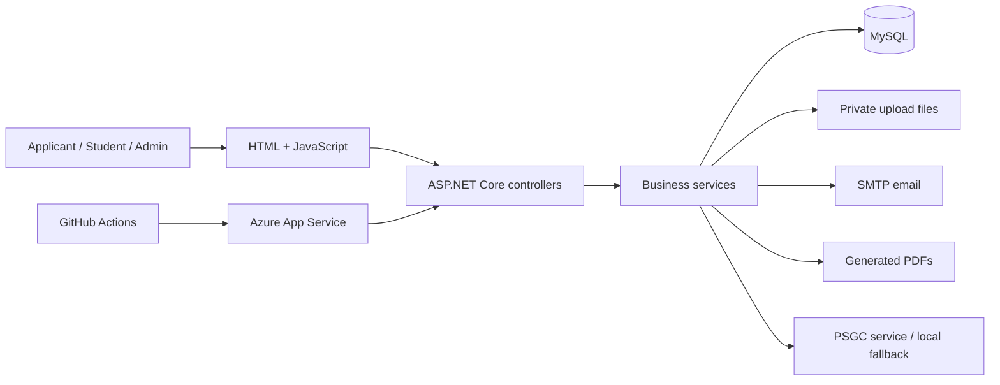

# ABEC full-system audit — November 7, 2026

**Assessment: a functioning system foundation with material security and reliability gaps. Not ready for unrestricted production use with personal records.** The highest priorities are server authorization, protection of email configuration and credentials, consistent business transactions, and a supported deployment platform.

The implementation checklist is [ALL-AROUND-TO-FIX.md](../../ALL-AROUND-TO-FIX.md). Database-specific migration detail remains in [DATABASE-TO-FIX.md](../../DATABASE-TO-FIX.md). Neither plan marks fixes complete.

## 1. Scope and evidence

This audit examined the current application source, build/publish configuration, frontend scripts and HTML, workflow services, integration code, and GitHub Actions deployment. It carries forward the earlier same-day database inspection, with its original scope and limitations.

| Check | Result and limits |
|---|---|
| Application inventory | 20 controller source files, 92 HTTP-action attributes, 25 service source files, 27 application JS files, 21 static HTML pages. These are source counts, not 92 tested endpoints or an exact effective route count. |
| Authorization inventory | Only `StudentAccountController` contains `[Authorize]`; no application fallback authorization policy. Intended public actions still require a deliberate allowlist. |
| JavaScript syntax | 27 application files plus 38 extracted inline scripts: **65/65 passed Node syntax checks**. Syntax success does not prove browser behavior. |
| Static HTML/assets | No missing checked literal HTML asset/page paths, duplicate static IDs, missing HTML `lang`, or images lacking an `alt` attribute. Three Leaflet CSS image references are missing. Dynamic URLs and accessible-name quality were not proved. |
| Client behavior | Isolated Node VM with mocked fetch reproduced duplicate POST execution after a lost response, and loss of standard ProblemDetails validation messages. No real endpoint or database was called. |
| Release publish | Succeeded with no diagnostics emitted in this invocation; **309 files**, including all 21 HTML pages. Checked local settings/private paths were absent. This is a path-exclusion check, not a complete artifact secret scan or production deployment. |
| NuGet advisory query | `dotnet list ... package --vulnerable --include-transitive --format json` completed and reported no vulnerable package entries. A feed-based package check does not cover the hosted runtime, CDN scripts, all native assets, or unknown vulnerabilities. |
| Earlier local database evidence | 18 tables, 442 rows, 16 existing FK links with no orphans. Details and exceptions are in the [database audit](database-audit-2026-11-07.md). Not re-counted during this system pass. |
| Existing live QA/import reports | Read as historical evidence. The old connection-string HTTP-500 incident was resolved in the recorded retest; it is not listed as a currently reproduced outage. |
| Not performed | Fresh production database/settings inspection, authenticated browser journey, mobile/keyboard/screen-reader audit, live exploit attempts, real enrollment/upload/email submission, production load test, Azure file transfer, or coordinated recovery. |

The application was not started against business data because startup invokes database changes. Existing test/QA/import evidence was not relabeled as newly executed. New helper scripts and outputs live under ignored `App_Data/system-audit/`; the public evidence summary is [system-audit-evidence-2026-11-07.json](system-audit-evidence-2026-11-07.json).

## 2. How the system works, in plain language

The browser presents HTML, CSS, and JavaScript. Its JavaScript calls API controllers in one ASP.NET Core application. Services implement enrollment, decisions, confirmation, activation, schedules, documents, archive, and reporting data. EF Core/MySqlConnector reads and writes MySQL. Uploads are separate private files on disk, SMTP sends mail, QuestPDF generates PDFs, and PSGC lookups supply address choices. GitHub Actions builds the application and deploys it to Azure App Service.

The system is a single deployable web application, with several distinct stores and outside dependencies. A successful database update does not guarantee a document was saved, an email arrived, or a page displays the correct batch. A successful website build likewise does not prove that a visitor is authorized to read a student's record.

The intended journey is registration → staff decision → slot response → enrollment/activation → training → document processing → retained history. Several current paths disagree about what a state means or where a transaction begins. Those disagreements explain many of the issues below.

## 3. Strengths to preserve

- Business logic is organized into services and DTOs; EF has a design-time factory that avoids booting the website for tooling.
- Existing Student account endpoints use cookie authentication and derive their own account ID from claims.
- Password creation uses BCrypt; Student credential changes check the existing password when credentials already exist.
- Registration uploads use generated storage names, extension/header checks, and private storage outside the public web root. These protections need strengthening, not removal.
- Many frontend rendering paths use escaping or `textContent`; the presence of `innerHTML` alone is not evidence of an exploitable XSS vulnerability.
- Health, error handling, user feedback, address fallback/cache, explicit slot-confirmation forms, and some integration verification already exist.
- Git/publish exclusion rules protect common local settings/private directories. The pipeline uses Azure federated login/OIDC rather than an embedded publish password.
- Current frontend syntax and a Release publish pass. The architecture can be repaired incrementally without a forced framework rewrite.

## 4. Findings

Evidence labels: **Source verified** means the behavior is visible in current code; **Reproduced** means exercised by the stated safe check; **Inherited** means same-day prior audit evidence; **Needs host verification** means application code alone cannot establish actual Azure behavior.

### SYS-01 — Critical: authentication and authorization are incomplete

**Source verified.** Sensitive applicant, student, administrator profile/settings, activation, archive, schedule, request, notification, and file routes generally lack authorization. Admin login returns JSON without an authenticated Admin session. Browser `sessionStorage` and a caller-provided `X-Abec-Admin-Id` do not prove identity. The protected Student account controller does not secure legacy routes.

**Plain meaning:** hiding an Admin screen or redirecting a page is not a lock on its API. Server permissions must protect every operation, including downloads and bulk actions.

**Repair:** establish Admin sessions/policies; Student ownership; a deliberate public-route list; trusted actor claims; consistent 401/403 handling and client session recovery. Include session revocation and cookie/CSRF design. Maps to DB-01.

Evidence: [Program](../../Program.cs), [AuthController](../../Controllers/AuthController.cs), [StudentApiController](../../Controllers/StudentApiController.cs), [AdminProfileController](../../Controllers/AdminProfileController.cs), [API client](../../wwwroot/js/abec-api.js).

### SYS-02 — Critical: unprotected email configuration controls mail and applicant-link destinations

**Source verified.** `/api/admin/email-settings` permits settings reads/writes without an authorization attribute. `EmailConfigService` accepts a host/port and public base URL, retains the existing password when a replacement is blank, and writes a password-bearing `smtp.local.json`, including an optional Debug-output mirror.

**Plain meaning:** someone reaching this API can attempt to change how the system sends mail and where its applicant links point. Combined with missing authorization, this threatens confidentiality and enrollment integrity. No setting was changed or destination contacted during this audit.

**Repair:** protect configuration with authenticated administrative permissions; prefer host-managed secrets; restrict approved SMTP/link destinations; audit changes; avoid unnecessary secret copies. Test effective settings under environment overrides and read-only deployments. Do not mistake URL syntax/private-IP checks for reachability or ownership verification.

Evidence: [AdminProfileController](../../Controllers/AdminProfileController.cs), [EmailConfigService](../../Services/EmailConfigService.cs), [Program configuration precedence](../../Program.cs).

### SYS-03 — Critical: login secrets and legacy activation are unsafe

**Source verified; inherited database evidence.** General Student DTOs expose PINs, PIN generation uses personal information, and public legacy registration can activate an account using its PIN. Admin verification permits plaintext fallback, although the two inspected local admin values had BCrypt-style prefixes. Settings duplicate Admin credential fields.

**Plain meaning:** a login secret should not be ordinary profile data or something derived from facts about a person.

**Repair:** remove secrets from routine responses, close the activation bypass, introduce random expiring single-use activation with a supported account transition, and retain one authoritative password store. Preserve existing users' access through a tested migration. Maps to DB-02/DB-12.

Evidence: [AuthService](../../Services/AuthService.cs), [SecurityPinGenerator](../../Services/SecurityPinGenerator.cs), [StudentPortalService](../../Services/StudentPortalService.cs), [UserSetting](../../Models/UserSetting.cs).

### SYS-04 — High: session behavior and login promises need one contract

**Source verified; host behavior unverified.** The UI stores its own role/ID while the server authenticates only Student cookies. `RememberDevice` is sent but the sign-in path does not use it to choose persistence. Logout clears browser session data and fires a best-effort Student logout request; it does not await confirmation. No custom session-revocation/data-protection setup is present in application code; platform defaults may supply key persistence and require verification.

**Plain meaning:** the browser can think a user is signed in while the server disagrees, or display account data after a failed logout. “Remember me” is not implemented end to end.

**Repair:** server-derived session bootstrap, explicit persistence policy, awaited logout with failure handling, account/credential revocation checks, and verified cookie-key behavior on restart/scale/deployment. Treat cached browser identity as display state only.

Evidence: [AuthController](../../Controllers/AuthController.cs), [Program](../../Program.cs), [login JS](../../wwwroot/js/abec-login.js), [shared client](../../wwwroot/js/abec-api.js). [Microsoft data-protection guidance](https://learn.microsoft.com/en-us/aspnet/core/security/data-protection/configuration/overview?view=aspnetcore-8.0).

### SYS-05 — High: upload resource limits and download content handling need strengthening

**Source verified.** Public registration permits 100 MiB per file and approximately 520 MiB per request. Global form value/header lengths are effectively unbounded in application configuration. Registration stores caller-supplied `ContentType`; downloads can return that type inline. Extension and short magic-header checks do not establish that a whole document is safe. The registration download path also lacks the explicit full-path containment check used by other document services.

**Plain meaning:** large or repeated public uploads can consume resources, and a document's self-declared content type should not decide how the browser executes/renders it. Stored-path corruption is another reason to enforce containment, even when normal writes generate safe paths.

**Repair:** agree practical upload sizes/counts, enforce limits at all hosting layers, bound form fields and request concurrency, derive MIME from validated supported types, default to safe download behavior, apply containment consistently, and decide quarantine/scanning requirements. No live resource-exhaustion or browser payload test was performed.

Evidence: [limits](../../Constants/SystemConstants.cs), [Program](../../Program.cs), [IIS limits](../../web.config), [registration storage](../../Services/ApplicantRegistrationStorageService.cs), [ApplicantController downloads](../../Controllers/ApplicantController.cs). [Microsoft upload security guidance](https://learn.microsoft.com/en-us/aspnet/core/mvc/models/file-uploads?view=aspnetcore-10.0).

### SYS-06 — High: registration validation and partial-success behavior are inconsistent

**Source verified.** Enrollment JSON is manually deserialized, so normal action-model validation is not automatically applied to that DTO. The legacy route accepts registration without uploads. The multipart workflow saves the application before validating/storing all mandatory files and can return success with an upload-failure message. Service validation exists, but manual deserialization, differing DTO/model lengths, and separate stages need one contract.

**Plain meaning:** “submitted successfully” can mean the registration exists but its required evidence is incomplete. A retry may then hit a duplicate record instead of completing the upload.

**Repair:** validate before durable effects, define Draft/Incomplete/Submitted semantics, make resumption idempotent, align validators, and decide whether legacy no-file enrollment remains supported. Return field errors that the UI can display.

Evidence: [ApplicantController](../../Controllers/ApplicantController.cs), [ApplicantService enrollment methods](../../Services/ApplicantService.cs), [registration storage](../../Services/ApplicantRegistrationStorageService.cs), [request DTOs](../../DTOs/RequestDtos.cs).

### SYS-07 — High: generic client retries can repeat writes and lose validation detail

**Reproduced in an isolated VM; source verified.** The shared client retries network exceptions for all verbs; form POST has its own four-attempt loop. A simulated committed POST whose response was lost produced **two simulated writes** before success. A standard HTTP-400 validation ProblemDetails object became `success=false` with an empty message. No real transaction was duplicated.

There is no request deadline/AbortController in the shared fetch path. HTTP status/field errors are not preserved consistently, and most business failures are returned as HTTP 200 by controllers.

**Plain meaning:** a connection problem can make one click run twice, and a correct validation rejection can look like an unexplained failure.

**Repair:** retry reads selectively; require server idempotency for repeatable commands; normalize API and ProblemDetails errors; preserve status and field errors; define timeout/cancellation; handle 401/403/429 distinctly. Coordinate with transaction/outbox work.

Evidence: [shared API client](../../wwwroot/js/abec-api.js), private `App_Data/system-audit/client-checks.json`.

### SYS-08 — High: Student schedule output can cross batches and omits recurrence

**Source verified.** `StudentPortalService.GetScheduleAsync` selects Active schedules for the student's course but does **not filter by the student's batch**. Its mapping omits `TrainingDays` and complete trainer assignments. The frontend accepts the returned list and marks only individual `scheduleDate` values in its calendars. Schedule notifications are sent to all students in a course and also on Inactive schedule creation.

**Plain meaning:** students can see or receive notices for another batch, and a recurring class can appear as a single day. This is additional to the room-conflict/history defects in DB-07.

**Repair:** scope by authorized enrollment/batch, return the required recurrence/date-range/trainer contract, render actual scheduled occurrences, and notify only affected students on meaningful published changes.

**Correction to older prose:** the current source does not perform the batch filter that earlier documentation described. Current source takes precedence; do not preserve that assumption in tests.

Evidence: [StudentPortalService](../../Services/StudentPortalService.cs) around line 131, [student JS](../../wwwroot/js/abec-student.js), [ScheduleService](../../Services/ScheduleService.cs).

### SYS-09 — High: lifecycle, transaction, history, and completion rules disagree

**Source verified and inherited exceptions.** Confirmation/student creation and other multi-save actions need a service-owned transaction across every entry point. Capacity checks on direct slot-response paths can precede their transaction. Closed-batch write rules omit schedules and can prevent staff processing of legitimate historical requests. Request transitions differ from prepared-file release, which can close open requests directly. Calendar-day request eligibility differs from batch-end release timelines and actual training/OJT completion.

**Plain meaning:** modules can tell different stories about the same person, seat, or document. A closed semester must preserve history without silently stranding alumni service.

**Repair:** accepted transition matrix, seat policy, historical-access rules, explicit completion evidence, atomic/idempotent commands, and retained lifecycle events. Resolve the known data exceptions case by case. Maps to DB-07/DB-09/DB-12/DB-13.

Evidence: [ApplicantService](../../Services/ApplicantService.cs), [BatchWriteFilter](../../Services/BatchWriteFilter.cs), [BatchIntegrity](../../Data/BatchIntegrity.cs), [DocumentRequestService](../../Services/DocumentRequestService.cs), [CourseDocumentService](../../Services/CourseDocumentService.cs), [CourseProgram](../../Services/CourseProgram.cs).

### SYS-10 — High: notifications have privacy, ownership, and count problems

**Source verified.** Archived Student notifications, including message content and owner identifiers, use one origin-wide localStorage key. Rendering loads all stored archive items without user partitioning, and ordinary logout does not clear that archive. On a shared browser profile this creates a cross-account disclosure risk. Admin read state is one shared notification status, and its badge counts unread items only among the latest 50 returned results. Some audience/category behavior is inferred from title strings.

**Plain meaning:** local notification “archive” is not a private server archive; different users on the same browser may see old content, and the badge may undercount or share read state unexpectedly.

**Repair:** authenticated owner-scoped persistence, safe cleanup/migration of existing local archives, explicit event type/audience, defined per-admin/shared read semantics, and an independent unread count. Preserve relevant history.

Evidence: [notification JS](../../wwwroot/js/abec-student-notifications.js), [admin JS](../../wwwroot/js/abec-admin.js), [NotificationService](../../Services/NotificationService.cs), [NotificationController](../../Controllers/NotificationController.cs).

### SYS-11 — Medium: reports and dashboard metrics need agreed definitions

**Source verified.** Dashboard AwaitingActivation counts all Inactive students, including archived accounts. Approved includes confirmed statuses; Rejected includes declined. Statistics are generally all-time, while screens also expose semester concepts. Reports fetch complete underlying lists and aggregate in the browser; current archive state cannot reconstruct every historical event. Date filters use browser-local dates.

**Plain meaning:** the displayed number may not mean what its label suggests, and reports can change when current records are edited even when reporting an old period.

**Repair:** define each metric's population, batch/date scope, status/event meaning, timezone, and QA exclusion. Compute authorized aggregates on the server, make partial data explicit, and reconcile sample results to SQL/event evidence. Do not claim historical point-in-time reporting without historical facts.

Evidence: [ApplicantService stats](../../Services/ApplicantService.cs), [report JS](../../wwwroot/js/abec-reports.js), [archive behavior](../../Services/ArchiveService.cs).

### SYS-12 — High: email delivery is synchronous and configuration success is misleading

**Source verified; production SMTP unverified.** SMTP runs during business requests with an independent 90-second timeout; some surrounding transactions can remain open. Files in `email-outbox` are troubleshooting copies written even when email is disabled, not a durable delivery queue. Failures return SMTP details; original exceptions are also logged. Saving JSON can be overridden by higher-priority environment configuration. A URL is described as remotely usable based on syntax/IP heuristics rather than a reachability check. TLS settings always choose STARTTLS when UseSsl is true, which does not cover every SMTP port/mode.

**Plain meaning:** a slow email provider can stall a business operation; a saved setting or pickup copy does not prove a message was delivered.

**Repair:** transactional outbox and worker, deduplication/retry limits, delivery-state UI, explicit transport modes/timeouts, restricted configuration ownership and effective-settings feedback, redacted diagnostics and pickup retention. Verify one authorized test recipient only when delivery testing is requested.

Evidence: [EmailService](../../Services/EmailService.cs), [EmailConfigService](../../Services/EmailConfigService.cs), [ApplicantService](../../Services/ApplicantService.cs), [Program](../../Program.cs).

### SYS-13 — High: database drift, excessive privileges, and startup changes remain

**Inherited and source verified.** Local/recorded Azure schema differences, contact duplicates, missing constraints, root runtime access, mixed collations, startup DDL/data/PIN rewrites, query growth, and incomplete historical audit are covered in DB-03 through DB-13. A database can accept a connection while its intended upgrade remains incomplete.

**Repair:** execute the database plan's canonical-schema, data-review, migration, privilege, history, time, and performance packages. Do not apply InitialCreate over occupied tables or silently replace historical contacts. The earlier local credential exposure still requires controlled rotation; this pass did not print settings values or rotate credentials.

Evidence: [database audit](database-audit-2026-11-07.md), [database plan](../../DATABASE-TO-FIX.md).

### SYS-14 — High: document persistence and full recovery are not proven

**Inherited; source verified.** Five referenced originals were missing locally; the Azure transfer remained pending in previous evidence. Filesystem replacements and database commits are separate, and some paths delete old files before new metadata is durable. Runtime data under the application content root needs explicit persistence verification across deployment/scale. A schema backup is not a backup of uploaded documents or cookie keys.

**Repair:** staged immutable object replacement, availability states, reconciliation, durable private storage, coordinated database/file backup and restore, and verified ownership after Azure mapping. Establish recovery objectives and exercise a complete recovery.

Evidence: [import report](local-to-azure-import-review.md), [document services](../../Services/ApplicantRegistrationStorageService.cs), [database plan W07/W12](../../DATABASE-TO-FIX.md).

### SYS-15 — High, time-sensitive: .NET 8 support ends November 10, 2026

**Source verified and externally verified.** The project targets `net8.0`; CI selects `8.x`. As of the audit date, end of support is three days away. Package-advisory success does not extend runtime support. The local SDK/runtime, build runner, and actual Azure runtime are separate inventories.

**Repair:** prioritize migration to a supported target, with .NET 10 LTS as the candidate. First verify EF/Pomelo/MySQL provider, PDF/native assets, deployment OS/runtime availability, cookie behavior, and application tests. Do not upgrade package majors or hosting settings blindly. Pin the build toolchain and establish patch maintenance. [Microsoft support policy](https://dotnet.microsoft.com/en-us/platform/support/policy/dotnet-core), [end-of-support notice](https://devblogs.microsoft.com/dotnet/dotnet-8-9-end-of-support/).

### SYS-16 — Medium: production frontend build, dependency, and browser-hardening gaps

**Source/static check verified; rendered UX unverified.** Eighteen pages load Tailwind Play CDN without integrity metadata. There is no frontend dependency/build manifest in the repository. Tailwind identifies Play CDN as development-only. Three Leaflet CSS image assets are absent. There are 156 inline event-handler attributes and a `document.write` script loader, which complicate a restrictive CSP. No application CSP/frame/content-type/referrer policy configuration was found; the host may add headers and must be checked.

**Plain meaning:** presentation depends on third-party runtime script delivery, and browser protection cannot simply be switched on without accounting for existing inline behavior.

**Repair:** pinned build-time CSS and local versioned assets, explicit dynamic-class coverage, shared components, dependency/license inventory, staged CSP/header rollout, and fixes for missing assets. Test actual browser/keyboard/mobile behavior; passing syntax and alt-presence checks is not accessibility compliance.

Evidence: [HTML pages](../../Views), [API loader](../../wwwroot/js/abec-api.js), `wwwroot/lib/leaflet/leaflet.css`. [Tailwind production guidance](https://tailwindcss.com/docs/installation/play-cdn).

### SYS-17 — High operational risk: proxy, HTTPS, cookies, and key persistence need host verification

**Source verified configuration limits; needs host verification.** HSTS/redirect enabling depends on the process URL containing HTTPS; Azure may terminate HTTPS at a proxy. No explicit trusted forwarded-header setup appears in application code. Cookie secure policy is not explicitly set to Always; the effective result depends on host/request scheme. IP-based throttling also depends on trustworthy client-IP forwarding. The app does not explicitly configure cross-instance/slot key storage.

**Repair:** inspect actual App Service platform integration/settings/response headers, define trusted proxies and original scheme/IP handling as appropriate, enforce HTTPS at the correct layer, and test secure cookies, rate-limit identity, restart/scale/slot sessions, and key protection. Do not assume absent custom middleware proves platform integration is absent. [Microsoft proxy guidance](https://learn.microsoft.com/en-us/aspnet/core/host-and-deploy/proxy-load-balancer), [data protection](https://learn.microsoft.com/en-us/aspnet/core/security/data-protection/configuration/overview?view=aspnetcore-8.0).

### SYS-18 — High: deployment lacks repository-defined quality and rollout gates

**Source verified; external repository/Azure protections unverified.** The workflow builds/publishes on main pushes or manual dispatch and deploys directly to Production. It has no PR test job, explicit test execution, artifact privacy check, migration/readiness check, deployment concurrency control, staged smoke gate, or rollback procedure. Actions use version tags rather than immutable commit pins. OIDC permissions are a positive starting point. Branch protection and environment rules outside the workflow were not inspected.

**Repair:** reproducible build, targeted automated tests, advisory/secret/artifact checks, managed migrations, serialized deployment, staging where available, safe smoke checks, promotion/health criteria, and compatible rollback/forward repair. Verify federated Azure role scope and repository/environment protections.

Evidence: [workflow](../../.github/workflows/main_abecwebapp.yml), [project file](../../ABEC%20System.csproj).

### SYS-19 — Medium: health and diagnostics are not operational readiness

**Source verified.** `/api/health` returns `ok=true` even when database connectivity is false. Startup upgrade failures are warnings while the process continues. Database error classification includes broad DbUpdate failures and can tell Azure users to start localhost MySQL. There is no explicit readiness schema/storage/outbox contract, correlation middleware, or alert configuration in the repository. Provider-side telemetry may exist and was not inspected.

**Repair:** separate liveness/readiness, classify configuration/connectivity/integrity/transient failures accurately, include correlation IDs, redact private data, and connect alerts to user-impacting failures and backup/queue health. Do not make liveness depend on every external provider.

Evidence: [Program](../../Program.cs), [EmailService diagnostics](../../Services/EmailService.cs), [deployment workflow](../../.github/workflows/main_abecwebapp.yml).

### SYS-20 — Medium: maintainability and regression coverage need deliberate improvement

**Source inventory verified.** README is empty. No conventional automated test project or PR test workflow is present; a standalone BatchVerification harness and previous QA scripts exist. Important services/pages/scripts span roughly 1,000–2,000 lines, with duplicated shells, status/format logic, and mixed static HTML/Razor routes. These are maintenance risks, not proof that each long file is defective.

**Repair:** runnable setup/architecture/runbooks, focused service/contract/integration/browser tests, small domain boundaries, shared frontend rendering/components, and removal/labeling of obsolete placeholder code after checking usage. Keep refactoring incremental and tied to changed behavior. Do not rewrite the frontend solely to reduce line counts.

Evidence: [README](../../README.md), [BatchVerification](../../scripts/BatchVerification/Program.cs), service/HTML/JS inventory.

### SYS-21 — Medium: location integration needs bounded validated inputs and portable maintenance

**Source verified; exploitability not demonstrated.** Province/city strings are trimmed and embedded in local file paths, remote URLs, and cache keys without a strict PSGC-code allowlist/length check. Local fallback does not explicitly enforce a canonical-root boundary. Invalid external requests can consume cache/network/log resources. The maintenance script hardcodes the older checkout path rather than this workspace. Cache/fallback is useful but outage behavior and coverage need tests.

**Repair:** validate known code shapes/existence, enforce file containment, bound caching/request rates/timeouts, define upstream outage/circuit behavior, version fallback data, and make updates portable and repeatable. This is not a claim of verified arbitrary-file disclosure or arbitrary-host SSRF; URLs use a fixed upstream base and typed deserialization.

Evidence: [LocationService](../../Services/LocationService.cs), [LocationController](../../Controllers/LocationController.cs), [refresh script](../../scripts/refresh_bicol_psgc.py).

## 5. Validation still needed before full sign-off

| Area | What remains unknown | Required verification |
|---|---|---|
| UX/accessibility | Actual focus order/traps, contrast, error announcements, keyboard menus, zoom, small screens | Browser journeys at desktop/mobile widths, keyboard and screen-reader checks, automated accessibility scan with manual review |
| End-to-end workflow | Real browser onboarding, uploads, staff decisions, alumni requests, notification ownership | Isolated synthetic journeys; no unsolicited delivery to real applicants |
| PDF/documents | Unicode/font rendering, long fields/page breaks, selected license eligibility, deployed native dependencies | Render representative synthetic PDFs on target OS; owner review of applicable component terms |
| Production controls | Current Azure grants/settings/headers, backups, file availability, actual hosted runtime, deployment permissions | Authorized read-only host/database/storage inspection and recorded evidence |
| Scale/recovery | Production-like request latency, upload concurrency, outbox recovery, restore duration | Isolated load/failure tests and coordinated restore against agreed objectives |
| Security completeness | Full dynamic attack-surface testing, tenant/owner coverage, all DOM sinks, secret history | Targeted authenticated/unauthenticated tests after containment; no claim this audit is a penetration-test certification |

## 6. Recommended order

1. Baseline and protect data/files; contain exposed APIs and configuration, remove PIN exposure, and prepare secret rotation.
2. Resolve account/session and platform lifecycle work urgently; select a compatible supported runtime without delaying immediate access-control repairs.
3. Establish canonical schema and explicit migrations; settle actual business policies before changing historical data.
4. Repair command idempotency, registration completion, schedules, notifications, reporting, document states, and reliable delivery.
5. Improve bounded queries, deterministic frontend build, accessibility and maintainability with targeted regression coverage.
6. Prove Azure configuration, staged deployment, monitoring, and recovery before full release acceptance.

The master plan maps every SYS finding, all DB findings, and the pending validation areas to concrete tasks and acceptance evidence. A repair is complete when the behavior is verified, not when its checkbox has merely been implemented.
