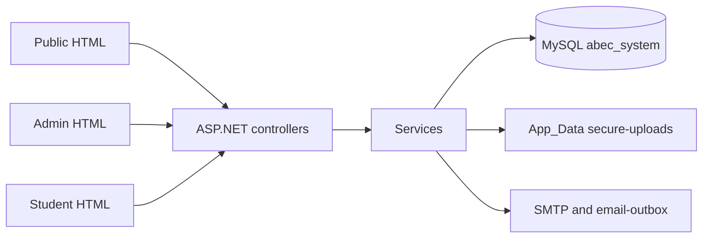
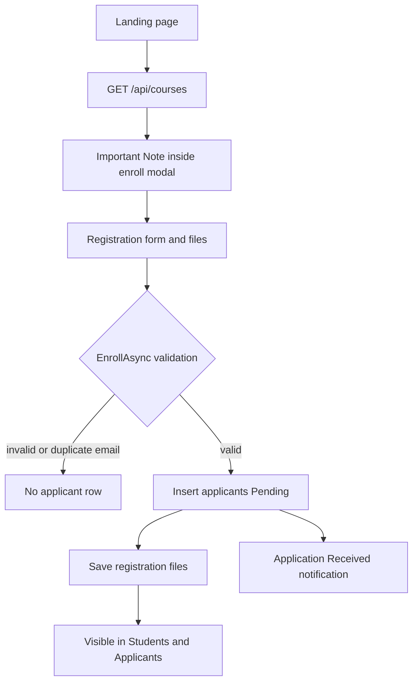
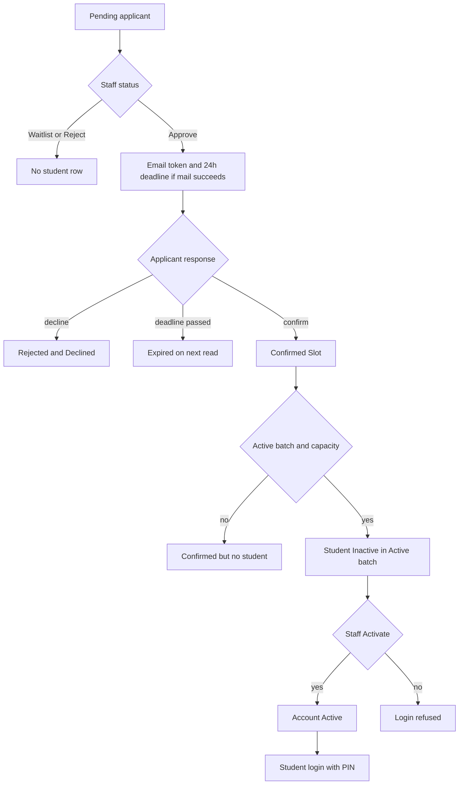
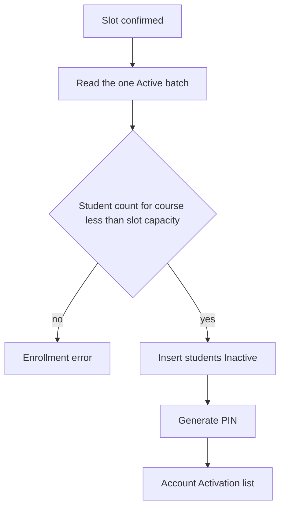
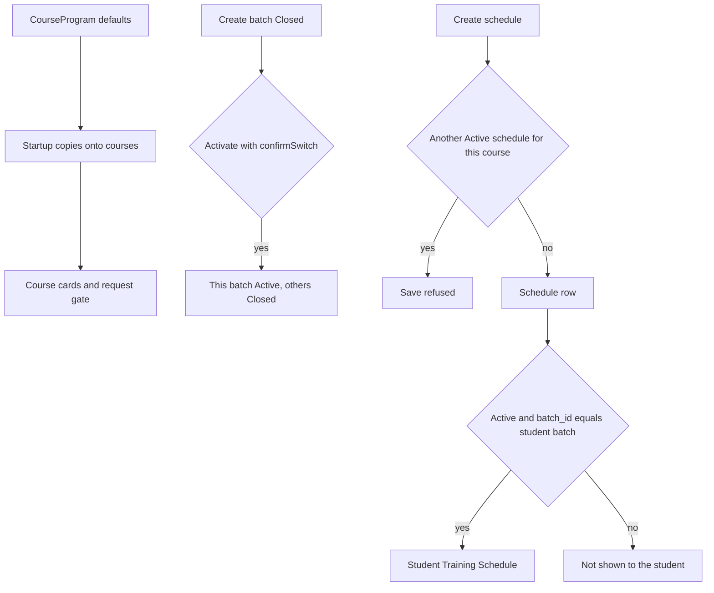
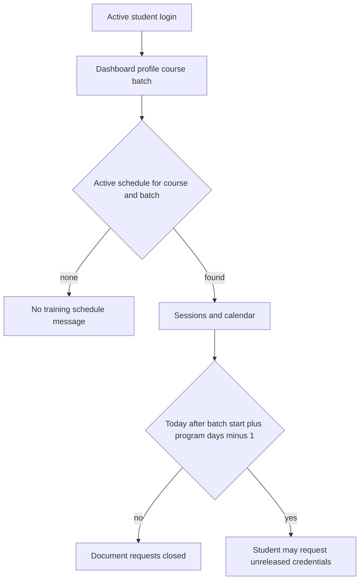
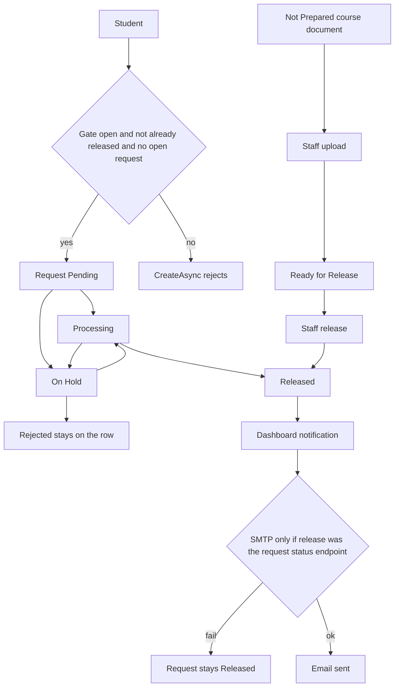
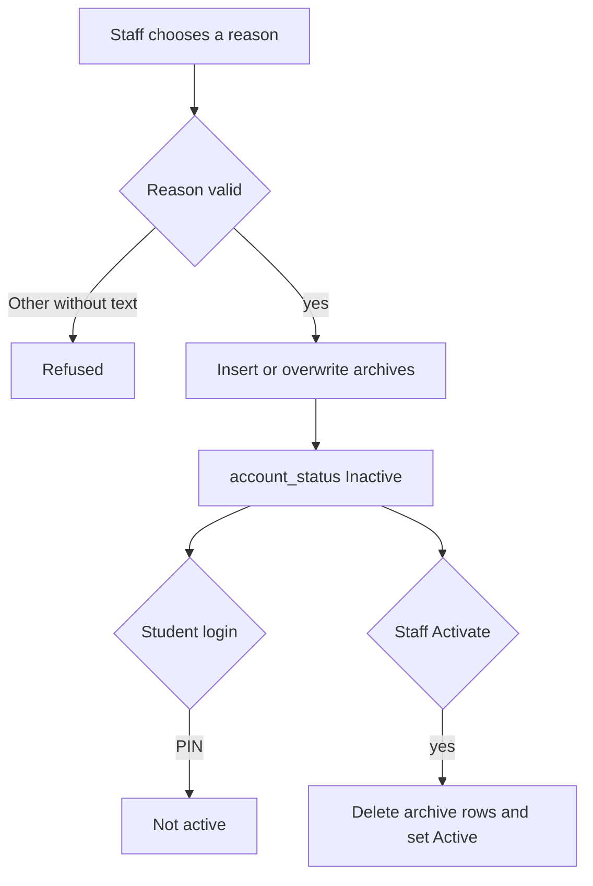
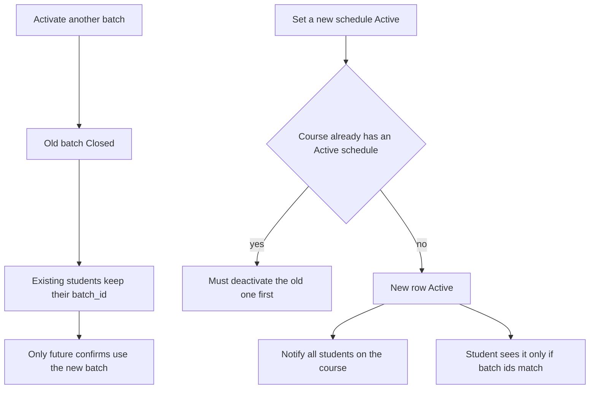
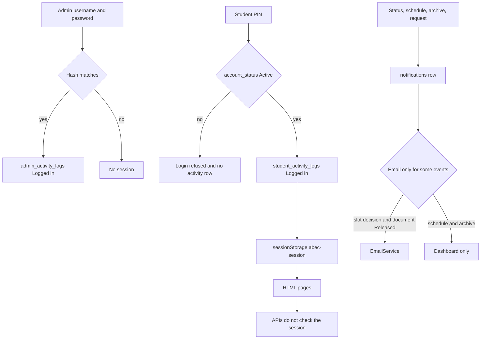

# 07 — System Flow Diagrams

Diagrams match the code paths in documents 02 through 06. Nodes marked UNVERIFIED are not used below; paths that do not exist are drawn as explicit stops.

## 1. Architecture

Page access is `sessionStorage` role check only. The API does not read that session.

## 2. Registration

## 3. Review and activation

Approve and Activate are separate manual actions. Activate does not enroll.

## 4. Enrollment and batch

No later step changes `students.batch_id`.

## 5. Course, batch, and schedule

## 6. Training lifecycle

The gate does not read attendance or the schedule row.

## 7. Documents

## 8. Archive

Graduated, Deactivated, Academic Dismissal, Withdrawal, Inactive Lead, and Other share this one path. The reason text differs. The data effect does not.

## 9. Batch switch and schedule replace

Student transfer between batches is not on this diagram because it is not implemented.

## 10. Authentication and notifications

Slot approval email is sent from `ApplicantService`. Document Released email is sent from `DocumentRequestService.UpdateStatusAsync`. Activation does not email the PIN.
